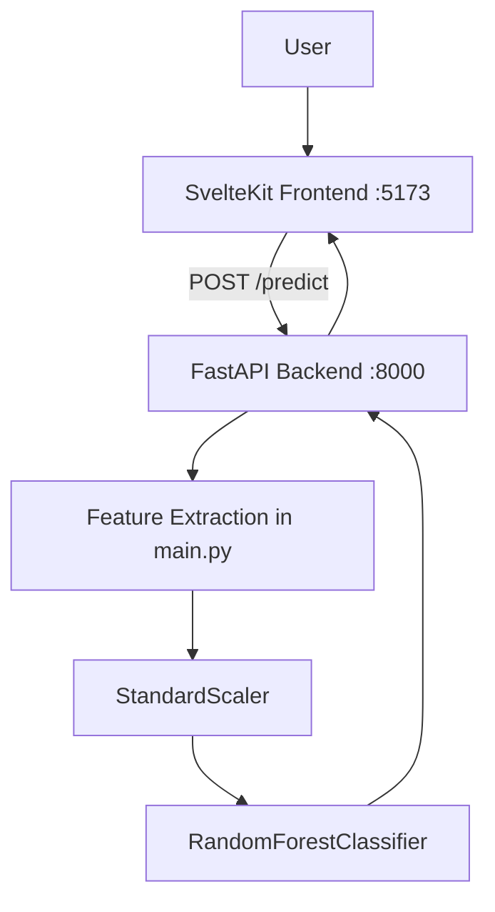

# Phishing URL Shield

[](https://fastapi.tiangolo.com/)
[](https://svelte.dev/)
[](https://scikit-learn.org/)
[](https://www.python.org/)
[](https://www.typescriptlang.org/)

Real-time phishing URL detection app with a FastAPI backend, SvelteKit frontend, and a notebook-driven Random Forest training pipeline.

## What This Project Does

Phishing URL Shield analyzes a URL and returns:

1. Binary verdict: Legitimate or Phishing
2. Risk score percentage
3. Full extracted feature map used by the model
4. Recent scan history for dashboard display

The current implementation uses lexical and structural URL signals plus typo-brand indicators, then predicts with a Random Forest model.

## Current Architecture



## Repository Structure

```text
Phishing-URL-Detecting-Application/
├── app/
│   ├── backend/
│   │   ├── main.py
│   │   └── model/
│   │       ├── phishing_rf_model.pkl
│   │       ├── scaler.pkl
│   │       └── features_list.pkl
│   └── frontend/
│       ├── package.json
│       ├── src/
│       │   ├── routes/+page.svelte
│       │   └── lib/
│       │       ├── components/
│       │       ├── services/phishing-api.ts
│       │       └── types/phishing.ts
│       └── ...
├── ml-pipeline/
│   ├── dataset/dataset_phishing.csv
│   └── notebook/app.ipynb
├── requirements.txt
└── README.md
```

## Tech Stack

- Backend: FastAPI, Pydantic, scikit-learn, pandas, numpy, joblib
- Frontend: SvelteKit 2, Svelte 5, TypeScript, Vite
- ML Training: Jupyter Notebook pipeline in ml-pipeline/notebook/app.ipynb

## Setup

### Prerequisites

- Python 3.10+
- Node.js 18+
- npm 9+

### Backend Setup

```bash
cd Phishing-URL-Detecting-Application
python3 -m venv .venv
source .venv/bin/activate
pip install -r requirements.txt
```

### Frontend Setup

```bash
cd app/frontend
npm install
```

## Run the App

Open two terminals.

### Terminal 1: Backend

From project root:

```bash
source .venv/bin/activate
uvicorn app.backend.main:app --host 0.0.0.0 --port 8000 --reload
```

- API: http://127.0.0.1:8000
- Swagger: http://127.0.0.1:8000/docs

### Terminal 2: Frontend

```bash
cd app/frontend
npm run dev
```

- UI: http://localhost:5173

## API Endpoints

### GET /

Health and model status.

Example response:

```json
{
  "status": "Online",
  "model_loaded": true,
  "algorithm": "Random Forest Classifier",
  "features_count": 26
}
```

### POST /predict

Analyze single URL.

Request:

```json
{
  "url": "faceb00k.com"
}
```

Response shape:

```json
{
  "url": "faceb00k.com",
  "is_phishing": true,
  "status": "Phishing / Malicious",
  "risk_score_percentage": 67.7,
  "features": {
    "length_url": 20.0
  },
  "timestamp": "2026-10-25 12:00:00"
}
```

### POST /predict-batch

Analyze up to 100 URLs in one request.

Request:

```json
{
  "urls": ["facebook.com", "faceb00k.com", "http://faceb00k.com/login"]
}
```

If one URL fails, backend includes an error field for that item and continues remaining items.

### GET /model-info

Returns model metadata, feature names, feature importances, estimator count.

Note: benchmark_test_accuracy and benchmark_f1_score fields are currently static strings in backend output.

### GET /history

Returns recent in-memory scan list (max stored: 50, response returns top 20).

## Frontend Behavior

- Dashboard loads health, model info, and history on mount
- URL scan sends POST /predict
- Result card shows risk bar, prediction, timestamp, and analyzed URL
- Model panel shows algorithm, benchmark values, feature count, and feature names

Main API client is implemented in app/frontend/src/lib/services/phishing-api.ts.

## ML Pipeline (Notebook First)

Training is notebook-driven using ml-pipeline/notebook/app.ipynb.

Current notebook flow:

1. Load dataset
2. Clean duplicates and nulls
3. Map target labels (legitimate -> 0, phishing -> 1)
4. Build feature matrix from URL strings with typo-aware features
5. Add small synthetic typosquatting positives for known brands
6. Train/test split
7. Standard scaling
8. Train Random Forest (plus optional baseline models)
9. Evaluate metrics
10. Save artifacts directly to app/backend/model

Generated artifacts:

- app/backend/model/phishing_rf_model.pkl
- app/backend/model/scaler.pkl
- app/backend/model/features_list.pkl

No standalone retrain Python script is required.

## Current Feature Set (as saved in features_list.pkl)

Current model uses 26 features, including:

- Structural counts: dots, hyphens, slash, double slash, question mark, at sign, and others
- Host properties: subdomains, port, ip-host flag, suspicious tld
- Security/pattern flags: http token, shortening service, punycode, path extension, phishing hints
- Numeric ratios: digit ratio in URL and host
- Brand spoofing signals: brand_typo_flag and exact_brand_domain

## Known Notes

- History is in-memory and resets when backend restarts.
- Frontend API base URL is hardcoded to http://127.0.0.1:8000 in app/frontend/src/lib/services/phishing-api.ts.
- If retraining is done in notebook, restart backend to reload new model artifacts.

## Quick Sanity Check

With the current generated artifacts, sample outcomes are:

- facebook.com -> safe
- faceb00k.com -> phishing
- go0gle.com -> phishing
- http://faceb00k.com/login -> phishing

## License

MIT
